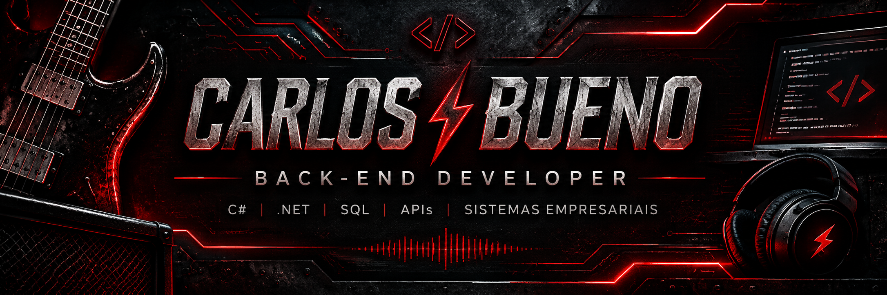
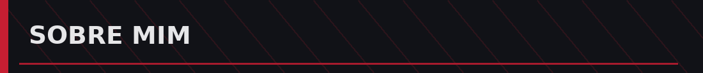
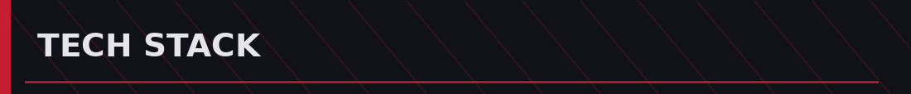
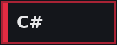
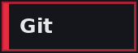
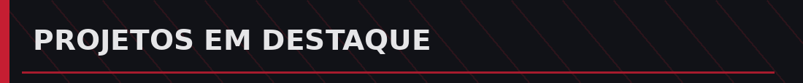
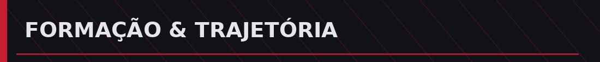
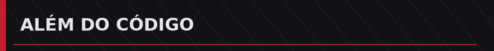
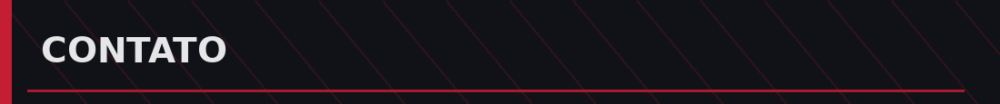

**Desenvolvedor Back-end em formação | C# · .NET · SQL**

*Transformando experiência com sistemas empresariais em soluções de software.*

Sou estudante de **Análise e Desenvolvimento de Sistemas**, em transição para desenvolvimento de software, com foco em **back-end C#/.NET e bancos de dados relacionais**.

Trago mais de **20 anos de experiência com sistemas empresariais**, implantação e parametrização de ERP, integrações e processos de negócio. Hoje aplico esse conhecimento no desenvolvimento de projetos práticos, buscando unir compreensão das necessidades do usuário, regras de negócio e soluções técnicas.

    

   

 

**Foco principal:** C#, .NET 10, ASP.NET Core, APIs REST, SQL e MySQL.  
**Em desenvolvimento e estudo:** Entity Framework Core, React e TypeScript, além de boas práticas de autenticação, autorização e testes.

### Sistema de Gestão Financeira Empresarial

Projeto em desenvolvimento com **C#, .NET 10, ASP.NET Core e MySQL**, voltado a operações financeiras e regras de negócio. Inclui trabalho com API REST, integração com banco de dados e evolução gradual de autenticação, permissões multiempresa e interface em React/TypeScript.

**Status:** em desenvolvimento. *Link do repositório será adicionado após confirmação de publicação.*

### SQL Sales Analytics

Projeto de modelagem e consultas SQL para explorar dados comerciais de clientes, produtos, pedidos e itens, utilizando MySQL.

**Status:** projeto de estudo. *Link do repositório será adicionado após confirmação.*

### Projetos Web

Landing pages e interfaces web desenvolvidas como projetos práticos, utilizando tecnologias de front-end e ferramentas de publicação.

[Ver meus repositórios públicos](https://github.com/carlosbuenodev-coder?tab=repositories)

- **Análise e Desenvolvimento de Sistemas:** graduação em andamento.
- **Ciências Contábeis:** graduação concluída.
- Experiência profissional em implantação, parametrização e integração de sistemas ERP.
- Aprendizado contínuo por meio de projetos práticos em back-end e bancos de dados.

Rock clássico e heavy metal fazem parte da minha personalidade. **AC/DC e Black Sabbath** estão entre minhas referências musicais. 🎸🤘

**Vamos conversar sobre tecnologia, projetos e oportunidades?**

[**LinkedIn — carlosbueno-dev**](https://www.linkedin.com/in/carlosbueno-dev) · [**GitHub — carlosbuenodev-coder**](https://github.com/carlosbuenodev-coder)

**KEEP CODING · KEEP ROCKING** ⚡

