

**Desenvolvedor Back-end em formação | C# · .NET · SQL**

*Transformando experiência com sistemas empresariais em soluções de software.*

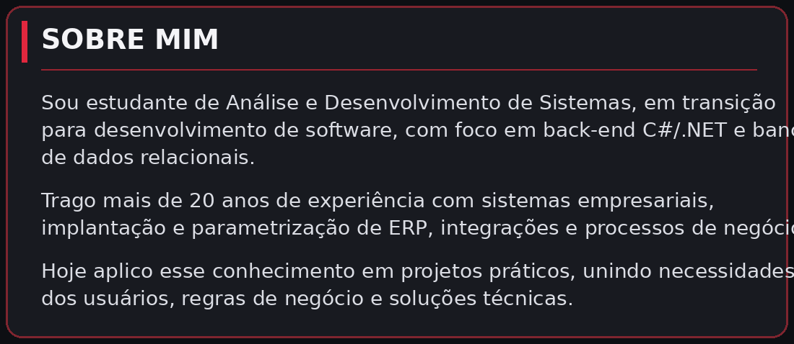

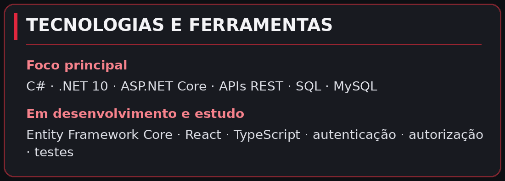

 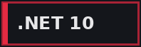 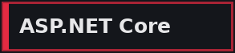  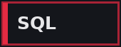

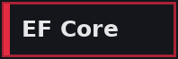   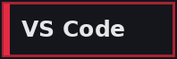

 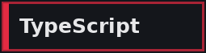

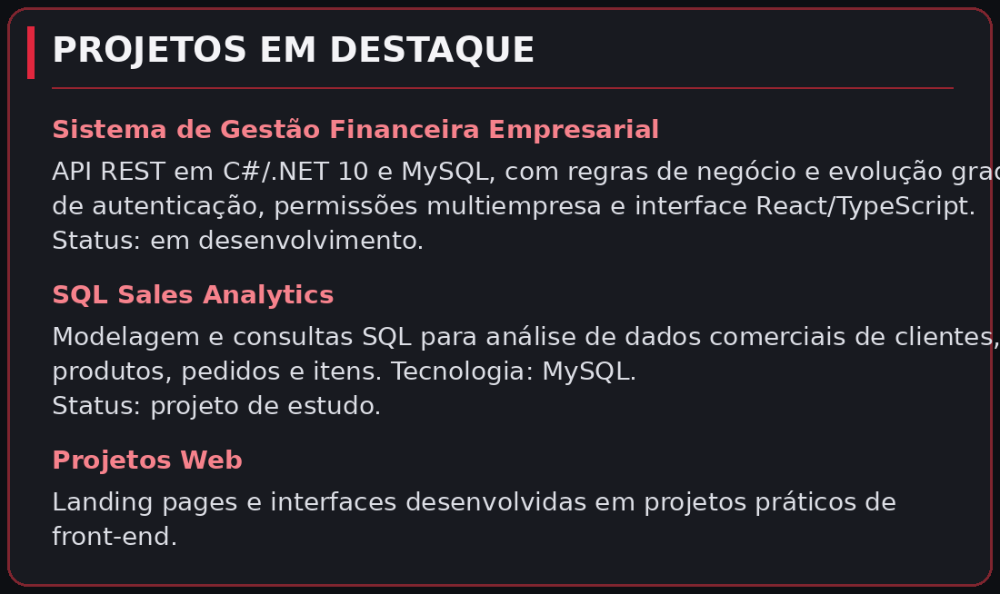

[**Explorar meus repositórios públicos**](https://github.com/carlosbuenodev-coder?tab=repositories)

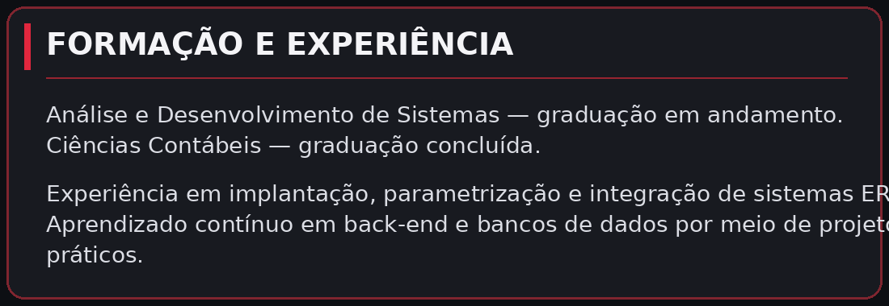

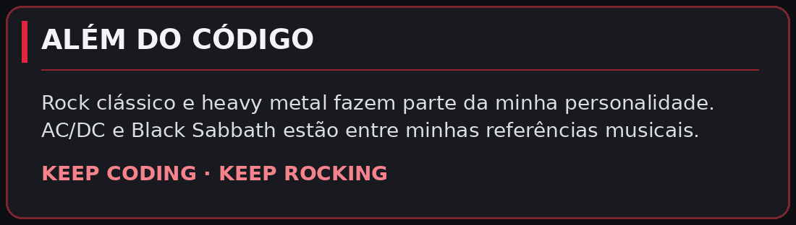

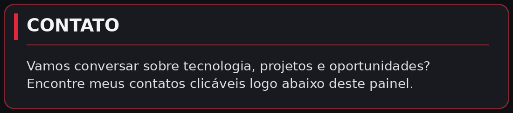

[**LinkedIn — carlosbueno-dev**](https://www.linkedin.com/in/carlosbueno-dev) · [**GitHub — carlosbuenodev-coder**](https://github.com/carlosbuenodev-coder)

